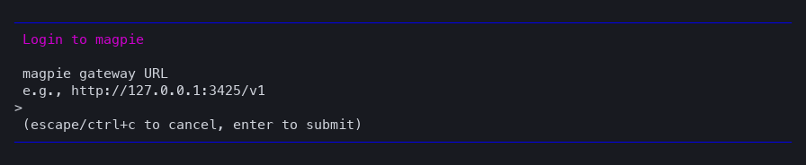
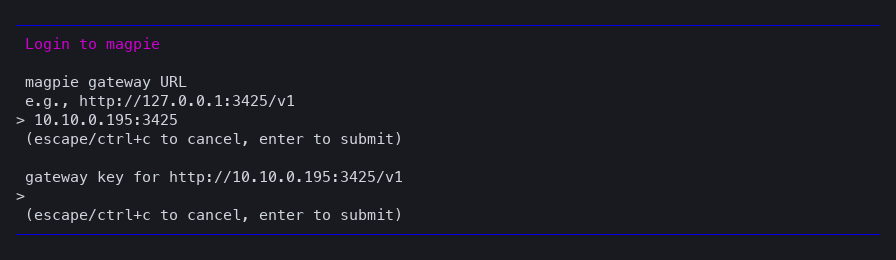
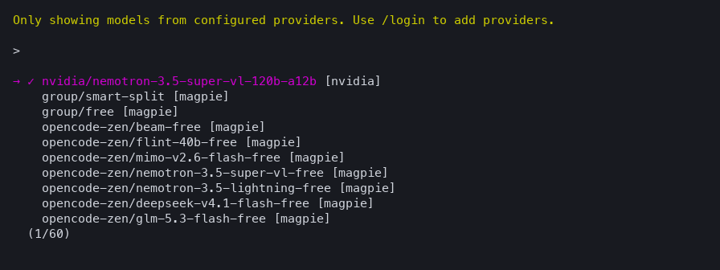

# @fradser/pi-magpie

Every [magpie](https://github.com/yetone/magpie) model and routing group in Pi's
model list, refreshed from magpie's live catalog, with magpie's effective prices.

magpie itself already wires Pi: picking a model there writes that model into
`~/.pi/agent/models.json` under a `magpie` provider. This extension goes one step
further — it registers the whole catalog served by the gateway
(`GET /v1/models`), so a model or routing group added, renamed or removed in
magpie appears in Pi without editing `models.json`.

## Requirements

A running magpie gateway and its key. Nothing else.

## Install

```sh
pi install npm:@fradser/pi-magpie
```

## Configure

Run `/login magpie`. It asks for two things and proves both before saving:



1. **Gateway URL** — press Enter for `http://127.0.0.1:3425/v1`, or type the
   address magpie runs on. A bare `10.10.0.195:3425` works: the `http://` scheme
   and the `/v1` prefix are added for you. An address that already has a path is
   kept as typed.
2. **Gateway key** — the second prompt names the gateway it will be checked
   against.



Pi then requests the catalog once. If the key is refused or the gateway is
unreachable, the login reports it and saves nothing — so a wrong URL shows up
immediately instead of as a timeout on your first turn.


After that the models are in Pi's picker, and every turn goes to the gateway you
logged in to:



The address is stored with the key in `~/.pi/agent/auth.json`, so nothing needs
to be exported afterwards:

```json
{ "magpie": { "type": "api_key", "key": "saved by /login", "env": { "MAGPIE_BASE_URL": "http://10.10.0.195:3425/v1" } } }
```

`/logout magpie` removes it.

### Environment instead of /login

For CI or a shared machine, skip `/login` and export:

| Variable | Meaning |
|---|---|
| `MAGPIE_API_KEY` | Gateway key. |
| `MAGPIE_BASE_URL` | Gateway origin, e.g. `http://10.10.0.195:3425/v1`. Default `http://127.0.0.1:3425/v1`. |
| `MAGPIE_PI_MODELS` | Comma-separated globs of model ids to expose, e.g. `group/*`. Unset lists everything. |

A stored credential wins over the environment for the key, and a gateway saved
by `/login` wins over both `MAGPIE_BASE_URL` and `models.json`.

### Why address precedence matters

Pi applies `models.json` above an extension per model, so a `baseUrl` there is
the one **requests** use. The extension therefore never invents a gateway: it
only overrides the address when `/login` stored one, or `models.json`/the
environment supplied one. Anything else would redirect traffic away from the
gateway you configured — which is exactly what happened when a saved key was
paired with a `models.json` gateway and the provider assumed `127.0.0.1`.

Each of these works on its own:

| Configuration | Gateway from | Key from |
|---|---|---|
| `/login magpie` only | saved with the credential | saved with the credential |
| `models.json` only, no `models` array | `baseUrl` there | `apiKey` there (literal, `$VAR`, or `!cmd`) |
| Environment only | `MAGPIE_BASE_URL` (default `127.0.0.1:3425/v1`) | `MAGPIE_API_KEY` |

They also combine: a `models.json` gateway with a `/login` key works, since the
key and the address are resolved independently.

## How the catalog updates

- At session start the extension asks Pi to refresh `magpie` over the network,
  at most once every five minutes per process.
- A successful refresh is persisted by Pi, so an offline start still lists the
  last known catalog.
- An error, a non-2xx answer or an empty catalog keeps the previous list.
- `pi update --models` forces a refresh on demand.

Thinking levels follow the efforts magpie reports per model, and `off` stays
unsupported because magpie exposes no per-request way to disable thinking.

## Pricing

The catalog request carries `X-Magpie-Prices: 1`, so magpie answers with
`magpie_price` for every model it can price: its **effective** price, after your
custom prices, catalog prices such as models.dev, and the multipliers that apply.
Pi's `cost` fields take those numbers directly — both are USD per million tokens
— so `/cost`, the footer and any cost ledger reflect what the gateway charges
rather than a vendor list price.

A model magpie has no price for keeps zero, and so does a routing group whose
members have different prices: magpie reports no single price for it, and
borrowing a member's would be wrong. `group/*` entries therefore bill as free in
Pi's figures.

`models.json` still wins per model. magpie's own `models` entries there carry
base prices, and those mask the effective ones — on one observed Bailian model by
about 17×. To bill from magpie's numbers, leave the `magpie` provider in
`models.json` without a `models` array, or pin exact prices in `modelOverrides`,
which applies above everything else.

## Run Pi in a container

The gateway just needs an address the container can route to. On Docker Desktop
for macOS, containers reach `10.10.0.1` and the internet but not other LAN hosts,
so a gateway on a NAS needs the host to forward it:

```sh
# on the host: forward 13425 to the gateway (any streaming TCP proxy)
node -e 'const http=require("node:http");http.createServer((q,s)=>{const u=http.request("http://10.10.0.195:3425"+q.url,{method:q.method,headers:{...q.headers,host:"10.10.0.195:3425"}},r=>{s.writeHead(r.statusCode,r.headers);r.pipe(s)});q.pipe(u)}).listen(13425,"0.0.0.0")'
```

Then run `/login magpie` in the container and answer
`http://host.docker.internal:13425/v1`. Catalog, model selection, streaming,
retries and error text all work through that path; verified inside
`node:24-bookworm-slim` with `pi` 1.4.0, including a cold start (seeded catalog),
a streamed turn, an upstream 429 passed through unchanged, and an offline start
restoring the persisted catalog.

## Troubleshooting

| Symptom | Cause |
|---|---|
| `/login magpie` reports an HTTP status | Wrong key, or the URL is not magpie's gateway. Nothing was saved. |
| No magpie models at all | Nothing configured: run `/login magpie`, or set `MAGPIE_API_KEY` plus a gateway. `pi auth check --provider magpie` reports `ready` or `not_ready`. |
| Worked only after a new shell | An older version made a saved key imply `127.0.0.1`, overriding the gateway in `models.json`. Upgrade: the key and the address are now independent. |
| Costs are zero | magpie reported no price for that model, or a `models` array in `models.json` overrides the live one. |
